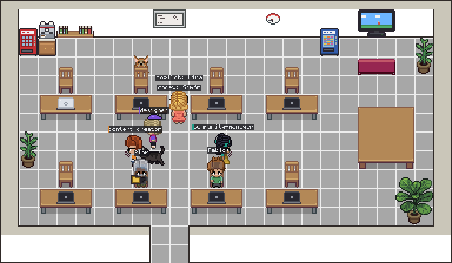
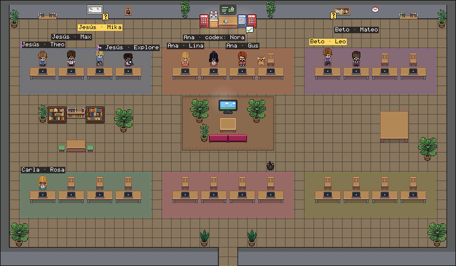

# deskmates

A pixel-art office where your AI coding agents work at their desks.

Every AI coding agent on your machine becomes a character: Claude Code, Codex (CLI and desktop app), GitHub Copilot CLI, Cursor and Gemini CLI, plus anything that posts to its API. It walks in, sits down, types while it edits, reads while it searches, stands up with a yellow **?** when it needs your permission, shows a green check when it is done, falls asleep when it goes quiet, and walks out when the session ends. Subagents sit next to the agent that launched them. Named agents wear their role: a beret for the designer, a headset for the community manager.



## Try it

```bash
npx deskmates demo             # opens http://127.0.0.1:47821 with simulated agents; Ctrl+C closes it
```

Nothing to install or configure, and no tokens spent: you need Node 22.18 or later. `demo --agents 12 --meetings 2` and more options in [Getting started](docs/getting-started.md#demo-mode).

## Quick start

```bash
npm install -g deskmates
deskmates serve                # the office at http://127.0.0.1:47821
deskmates connect              # your Claude Code sessions walk in
```

Codex, Copilot CLI, Cursor and Gemini CLI need no setup.

## What you see

- **One character per session**, with a short label: the name it chose, its role (`designer`, `Explore`) or a name that suits its character (`Sofía`, `Mateo`).
- **Hover or tap a character** for its card: its name, the session (`claude-work · id3a:designer`), the model, status, the tool and file it is using, folder, elapsed time and tokens.
- **Paper stacks on the desk** grow with the tokens the session has written.
- **A sound and a system notification** when an agent needs you, and a softer one when it finishes a job longer than two minutes. Mute with the bell; the choice is remembered per browser.
- **Several Claude profiles at once.** Sessions are told apart by their config directory, so `~/.claude` and `~/.claude-work` never collide.
- **A break room.** Agents that are done, or waiting for your answer for more than 15 seconds, take a break and come back when work resumes: a drink at the soda or snack machine, a coffee from the espresso machine, the sofa in front of the TV, or a game on it. The **?** follows them. Two or three having a drink side by side turn to each other and chat. Each theme brings its own break room (Cozy's sofa, Café's counter and tables).
- **Meetings.** When two agents of the same folder are free at the same time (a subagent does not count), they sit at the meeting table instead (a "…" or a little chart over its head). When the table is full it goes to the machines.
- **Handovers and greetings.** A subagent that finishes stops by the seat of the agent that launched it with a document bubble, then walks out. Two agents walking past each other wave.
- **Characters.** Eight deskmates characters (default), the six of Pixel Agents, or both (the **Characters** selector); give a role a character of your own in `roles.toml` ([Roles](docs/roles.md#characters)).
- **Pets.** Six office pets: Claudio the dog and Gitcat the cat from Pixel Agents, and four drawn from them for deskmates — Pascal the tuxedo cat, Biscuit the tricolour corgi, Nova the calico cat and Pip the lab rabbit. Two live in the office per open room (Claudio and Gitcat in the first; the next pair moves in when a room opens and walks out when it closes). They roam the whole office: they wander, walk out the door of one room and come in through the door of another, and go to sit next to an agent that is idle or asleep at its desk (one pet per agent). Two pets in the same room sometimes play tag; they bump into each other instead of overlapping, and in a narrow aisle one makes way. Choose two per room, all six, one of them or none with the pet selector in the header (`?pets=auto|all|<name>|off`).

## Documentation

| Guide | |
|---|---|
| [Getting started](docs/getting-started.md) | install, first run, keep it running, commands, uninstall |
| [Using deskmates](docs/usage.md) | reading the office, when an agent needs you, terminals, looks, pets, history, phone, demo |
| [Connecting your tools](docs/connecting-tools.md) | Claude Code profiles, Codex, Copilot CLI, Cursor, Gemini CLI |
| [Roles and outfits](docs/roles.md) | `roles.toml`, accessories, computers |
| [Themes](docs/themes.md) | picking themes and seasons, writing your own |
| [Other devices and machines](docs/lan-and-remote.md) | phone/LAN, remote agents, GitHub Actions runner |
| [Shared office](docs/shared-office.md) | one office for the team: every PC relays to a lab, a wall screen shows all |
| [Ingest API](docs/ingest-api.md) | send events from any tool |
| [MCP server](docs/mcp.md) | `deskmates mcp`: any MCP client reports itself, no adapter |
| [Troubleshooting](docs/troubleshooting.md) | `deskmates doctor` and common problems |
| [Architecture](docs/architecture.md) | how the pieces fit, rules the code keeps |
| [Contributing](CONTRIBUTING.md) · [Security](SECURITY.md) · [Roadmap](docs/ROADMAP.md) · [Backlog](docs/BACKLOG.md) | |

## Requirements

- Node.js 22.18 or newer
- `curl` (the hook uses it)
- Claude Code

## Install

`npm install -g deskmates` installs the `deskmates` command; `npm update -g deskmates` brings it up to date.

To run it from a clone instead (to change it, or to follow `main`):

```bash
git clone https://github.com/Jfernandez27/deskmates.git && cd deskmates
npm install
npm start                      # vite build && node bin/deskmates.ts serve
```

Run `npm link` once to call that clone as `deskmates`; after a `git pull`, `npm run build` (web page and CLI bundle) refreshes it.

## Connect a Claude Code profile

```bash
deskmates connect                          # $CLAUDE_CONFIG_DIR, or ~/.claude
deskmates connect --profile ~/.claude-work # any other profile
deskmates connect --all                    # every ~/.claude* profile
deskmates doctor                           # checks curl, the hook, the service and each profile
```

`connect` adds one hook per Claude Code event to `<profile>/settings.json`, each marked `"_deskmates": true` (an entry that runs only `deskmates-hook.sh` counts as ours even if Claude Code dropped the mark), after saving a timestamped backup next to it; a symlinked `settings.json` stays a link. Your existing hooks, plugins and settings are left exactly as they were. Run it again any time: it never duplicates entries.

```bash
deskmates disconnect --profile ~/.claude-work   # removes only what connect added
```

From a clone without `npm link`, run these as `node bin/deskmates.ts …`.

The hook is a three-line shell script, copied to `~/.config/deskmates/deskmates-hook.sh` so it survives node upgrades, that posts the event to `127.0.0.1:47821` with a 50 ms ceiling and always exits 0. If deskmates is not running, your agents do not notice.

## Themes

Pick a theme from the selector at the top right of the page, next to the bell; the choice is remembered per browser. `?theme=night` in the URL or `deskmates serve --theme night` set it too. Bundled: **Day**, **Night shift** (lights off, screens, the TV and the vending machines glow), **Cozy** (wood floor, rugs, lamps, a sofa), **Café / cowork** (bistro tables and an espresso counter), **Server room** (racks with blinking LEDs), **Library** (bookshelves and reading lamps) and **Headquarters** (one big floor with an island of desks per PC, the shared office's default). Seasonal decor (Halloween, Fiestas Patrias, Christmas and the seasons of the year) is off until you pick **Seasons** in its selector (`?season=auto|<id>|off`). Your own themes go in `~/.config/deskmates/themes/` and appear under **Yours** ([how](docs/themes.md#your-own-themes)). The wall clock shows the real time. More is on the [roadmap](docs/ROADMAP.md).

**On a tablet.** `deskmates serve --lan`, scan the QR it prints (or press the Share button on the page), then the kiosk button fills the screen. [More](docs/lan-and-remote.md).

## History

The **History** button at the top right opens today's history: who worked, for how long and how many tokens they used. It shows the day's totals, how many agents were active in each hour, and one row per session with a bar from when it was first to last seen (the bright part is its share of working time), its working and waiting time and its tokens. It refreshes every 30 seconds while open and works on a phone over `--lan`.

- Working time runs from a start or tool call until the agent waits, goes idle or ends. A silence of more than 10 minutes in the middle does not count.
- Each day is kept in `~/.local/state/deskmates/history/YYYY-MM-DD.json` (`$XDG_STATE_HOME` if set), written every 10 seconds while agents are active and on shutdown, and loaded again on start. A new day starts at local midnight.
- The files hold counts only: session ids, agent names, folders, times, tool call counts and token totals. Never prompts, commands, file names or contents.
- `GET /v1/history?date=YYYY-MM-DD` (today by default) returns `{date, sessions, totals: {sessions, workingMs, tokens}, hours}` with the same access rules as the page: from this machine, or from the network with the token in `--lan` mode.

## Other tools

`deskmates serve` also follows the session files these tools write, without touching their configuration:

| Tool | Reads | Notes |
|---|---|---|
| Codex CLI and Codex desktop | `~/.codex/sessions/**/rollout-*.jsonl` (`$CODEX_HOME`) | tools, tokens, idle per task |
| GitHub Copilot CLI | `~/.copilot/session-state/*/events.jsonl` (`$COPILOT_HOME`) | tools, tokens at the end, leaves on shutdown |
| Cursor agent (editor and CLI) | `~/.cursor/projects/*/agent-transcripts/*/*.jsonl` | lines have no timestamps; the file time is used |
| Gemini CLI | `~/.gemini/tmp/*/chats/session-*.jsonl` (`$GEMINI_CLI_HOME`) | tools and tokens per message |

These tools write no explicit "waiting for permission" or "session ended" line in every case, so their characters fall asleep after 10 quiet minutes (one waiting for you keeps its **?**) and leave after 30. Sessions that were already quiet when deskmates started are ignored. Turn this off with `serve --no-transcripts`. `deskmates doctor` lists which ones it found.

For anything else, add the [MCP server](docs/mcp.md) to its MCP settings or post events to the [ingest API](docs/ingest-api.md).

## Roles and outfits

`roles.toml` maps agent names to an outfit. Matching ignores the plugin prefix, so `id3a:designer` matches `designer`.

```toml
[roles.designer]
match = ["designer"]
color = "#7A4FD6"      # badge and label colour
accessory = "beret"    # beret | headset | notebook | magnifier | folder | toolbox | pen | book | globe
computer = "mac"       # laptop (default) | mac (silver laptop) | pc (tower)
```

Put your own in `~/.config/deskmates/roles.toml`: roles there override or extend the bundled ones.

## VS Code

`vscode/` holds a small extension that opens the office in a panel; clicking an agent there focuses the integrated terminal it runs in: Claude Code always; Codex, Copilot, Cursor and Gemini when only one session of that tool runs in that folder (found by process name and working directory, Linux and macOS). Build and install it with the steps in [vscode/README.md](vscode/README.md), then run **deskmates: Open office**.

## On your phone or another computer

```bash
deskmates serve --lan
```

prints a link like `http://192.168.1.20:47821/?token=…`. Open it once on the other device; a cookie keeps you in. Without `--lan` the office is reachable only from this machine. Hooks are always accepted only from this machine. Agents on other machines (a CI runner, a server) can post to the [ingest API](docs/ingest-api.md) at that address with the same token.

## Shared office

One deskmates on a lab machine can show the agents of several PCs on a wall screen: `deskmates serve --lan --shared` on the lab, `deskmates serve --relay http://lab:47821 --name "You"` on each PC. Each PC keeps its own office and has a colour and a name on the label; the wall screen is quiet. See [docs/shared-office.md](docs/shared-office.md).



The lab opens on Headquarters: one floor with an island of desks per PC, tinted with its colour. To see it without a lab, pick Headquarters in the theme selector and run `deskmates demo --pcs 4`.

## Privacy

- The service listens on `127.0.0.1` only (unless you pass `--lan`) and accepts hook events only from localhost.
- The ingest API needs the bearer token in `~/.config/deskmates/token`.
- Nothing leaves your machine unless you pass `--relay` or set `DESKMATES_RELAY` ([what is sent](docs/shared-office.md#what-is-shared)). No telemetry.
- The page never receives prompts, file contents or tool output: only the tool name and a short detail such as a file name or the first line of a command (at most 120 characters).
- Token totals are read from the session transcript on disk.
- The daily history files store counts and times only (see [History](#history)).

## How it works

```
Claude Code ──hook──▶ deskmates-hook.sh ──HTTP──▶ deskmates serve ──WebSocket──▶ page (canvas)
                                                   │  normalized events
                                                   │  pure reducer → office state
                                                   └  transcript tail → tokens
```

- `src/adapters/claude/` turns hook payloads into normalized events and reads token usage from transcripts.
- `src/core/` holds the pure reducer (status, desks, silence rules) and roles.
- `src/server/` receives events, keeps the state and broadcasts it.
- `web/` draws the office.

The design is in [docs/architecture.md](docs/architecture.md). Ideas for later are in [docs/BACKLOG.md](docs/BACKLOG.md).

## Development

```bash
npm test                                   # unit tests (vitest)
npx playwright test                        # browser tests and screenshots
DESKMATES_E2E_CLAUDE=1 npx playwright test # also runs a real Claude Code session (uses a few tokens)
npm run typecheck
```

The page has a demo mode for tests: `/?demo&t=1000` draws a fixed frame and exposes `window.__deskmates.setState(msg)`. Add `&walk` to let agents walk, take breaks, meet and be followed by the pets; `window.__deskmates.advance(ms)` then steps the scene clock (in 50 ms ticks) and redraws, so a screenshot after the same calls is always the same (see `tests/e2e/social.spec.ts`).

## Credits

The office art and characters come from [Pixel Agents](https://github.com/pixel-agents-hq/pixel-agents) by Pablo De Lucca (MIT), whose characters are based on the CC0 [Metro City](https://jik-a-4.itch.io/metrocity-free-topdown-character-pack) pack by JIK-A-4. The role accessories were drawn for deskmates. See [ASSETS.md](ASSETS.md).

## License

MIT
